# MedEvolve：基于双探索的纵向医疗任务生成与策略自进化

> 中文研究草稿。任务生成实验已完成，下游经验学习与四轮策略评测正在进行。

## 摘要

在患者纵向病历中自动构建医疗 Agent 任务，需要识别当前病例能够支持的临床关系，并确保相关证据可通过环境工具检索。本文提出 MedEvolve，通过数据探索提炼临床事件模式，通过环境探索核查证据获取方式，两类指导共同约束问题、参考答案与来源证据的生成。系统结合原始记录核验与独立解题反馈，跨患者批次修订生成指导并更新任务方向权重，推动生成策略自进化。研究在 PhysicianBench 与 MedAgentBench 中比较有效产出、任务质量和推理要求，并在共同官方任务上评价下游经验学习；任务生成实验覆盖两个环境、两个生成模型和六种方法；固定独立患者评测显示，策略更新的效果随环境与模型变化，未观察到一致的有效产量改善。下游经验学习按评分覆盖与原生学习触发状态报告，组件消融尚未执行。

## 1 引言与相关工作

MedAgentBench 与 PhysicianBench 将医疗 Agent 的评测置于可交互的电子病历环境中，要求 Agent 检索记录、整合信息并完成临床任务（Jiang et al., 2025；Liu et al., 2026）。这类任务的构建不只是选择可查询的事实。当问题跨越多次就诊时，答案依赖于治疗、检查与病情变化之间的关系。

不同病例能够支持的关系并不相同。连续检查与治疗调整可以支持治疗前后变化分析，单次就诊或缺少随访的记录则只能支持较局部的判断。即使题型相同，所需背景、时间窗口和证据也会随患者变化。因此，生成器需要先判断当前病例适合问什么，再组织具体任务。

工具执行轨迹描述的是信息访问过程，患者轨迹描述的则是已有诊疗过程。找到用药和检查记录，并不意味着这些检查可以用于比较治疗前后的变化；实际发生的后续处置，也不自动成为治疗规划的唯一答案。因此，增加工具调用不能单独说明推理加深，解题失败也可能来自证据不足或题意歧义。

TaskCraft 围绕抽取的答案构建原子任务，再通过深度和宽度扩展增加检索与组合依赖（Shi et al., 2025）。纵向医疗记录还需要前置判断：这些事实是否构成同一临床问题，以及当前病例允许提出什么推理要求。CuES 与 AgentEvolver 从环境交互中发现任务，并通过执行指导或参考解检验可行性（Mai et al., 2025；Zhai et al., 2025）。环境探索能够发现可执行操作，但相同工具面对不同患者会返回不同的证据关系，成功检索或重放不能单独验证临床解释。

MedEvolve 将可复用的临床模式、证据条件和检索方式共同组织为出题指导。数据探索识别可提问的关系，环境探索识别其证据获取方式，患者级核验与解题反馈则在解题模型固定的条件下推动生成策略自进化。研究在两个医疗环境中比较任务构建，在独立患者上检验生成指导更新，并通过共同官方任务评价合成任务的经验学习价值。

## 2 问题定义与方法

### 2.1 任务与生成策略

设患者 $p$ 的纵向轨迹为 $X_p$。任务记为 $\tau=(p,q,a,E)$，包含问题 $q$、候选参考答案 $a$，以及由来源标识和事实声明构成的证据集合 $E$。解题 Agent 接收问题、患者标识和必要上下文，通过环境工具访问记录；参考答案与证据声明保留在评价侧。

数据与环境探索分别得到指导 $K_D$ 和 $K_E$。第 $r$ 轮策略为 $\theta_r=(g_r,W_r)$，其中 $g_r$ 为自然语言生成指导，$W_r=\{(c_j,d_j,w_j)\}_j$ 包含临床题型、难度描述与非负权重。题型覆盖诊断与解释、检查与风险分层、治疗规划、药物处方和治疗重规划。每个生成位置按权重抽样：

$$
\Pr(z=j\mid W_r)=\frac{w_j}{\sum_k w_k},\qquad \sum_k w_k>0.
$$

抽样方向约束题型与推理要求，当前患者的证据决定具体任务是否成立。

### 2.2 双探索

数据探索读取进化患者轨迹，将事件角色、时间关系和证据条件归纳为指导 $K_D$。例如，治疗前后变化分析以治疗调整为事件锚点，并要求相关时段内可比较的检查记录。模式只适用于具备这些记录的病例；指导保留适用条件，目标患者记录决定具体问题。

环境探索通过只读工具交互识别可访问的记录类型，以及记录定位、关联检索和证据读取方式，形成指导 $K_E$。两类指导共同将临床证据需求与环境获取能力连接起来（图 1）。初始探索后，$K_D$ 和 $K_E$ 固定复用，后续反馈更新 $g_r$ 和 $W_r$。

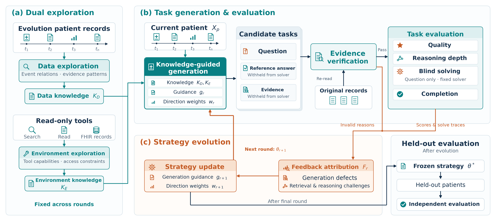

图 1. MedEvolve 方法概览。（a）双探索分别从进化患者的纵向记录和只读工具交互中归纳数据指导 $K_D$ 与环境指导 $K_E$，在后续轮次中固定复用。（b）生成器结合当前患者 $X_p$、探索指导、生成指导 $g_r$ 和方向权重 $w_r$ 构建问题、参考答案与来源证据。核验阶段重新读取原始记录；通过核验的任务进入质量、推理深度、独立解题与完成评价，参考答案和证据声明不提供给解题 Agent。（c）核验缺陷、评价结果与解题轨迹共同形成反馈 $F_r$，修订下一轮的生成指导与方向权重。进化结束后冻结策略，在独立患者上检验生成指导的迁移效果；该评测固定初始方向配比与抽样种子。

### 2.3 生成与证据核验

对患者 $p$，生成器通过一次模型调用读取预算内轨迹、两类探索指导、当前生成指导和两个抽样方向 $Z_{p,r}$，输出候选任务批次：

$$
\mathcal{T}_{p,r}=G(X_p,K_D,K_E,g_r,Z_{p,r}),\qquad |\mathcal{T}_{p,r}|\leq 2.
$$

生成器先选择事件关系，再组织问题、候选答案与逐来源声明。变化分析需将证据对应到事件锚点和比较时段；规划类答案需区分记录事实与推断，并容纳证据支持的等价方案。

公共核验重新读取引用的原始记录，先检查逐来源声明，再判断这些声明是否共同支持问题与答案。通过核验的任务进入质量、推理深度、独立解题与完成评价；未通过任务的缺陷原因进入反馈。

### 2.4 反馈驱动的自进化

反馈模型按患者读取轨迹、生成任务、核验与评分结果，以及解题记录，归纳任务缺陷、推理要求和修订建议，再跨患者汇总。证据不足、事实错误和歧义转化为提问条件的修订；对核验通过但未完成的任务，则结合工具轨迹与质量评价分析检索、推理困难或任务缺陷。

更新模型读取反馈与当前策略，输出新的指导和方向列表：

$$
F_r=\operatorname{Merge}\bigl(\{\operatorname{Feedback}(X_p,\mathcal{T}_{p,r},V_{p,r})\}_{p\in P_r}\bigr),
\qquad
\theta_{r+1}=U_{\mathrm{LLM}}(\theta_r,F_r),
$$

其中 $V_{p,r}$ 为评价与执行记录，$P_r$ 为本轮患者批次。生成指导积累事件选择、证据组织和答案表述的修订，方向权重调整后续采样。各轮患者互不重叠，解题模型保持固定；进化结束后冻结策略并开展独立评测。一次实际指导修订见附录 A.3。

## 3 实验设置

### 3.1 环境与对比方法

研究覆盖 PhysicianBench 与 MedAgentBench，生成患者池分别为 108 与 100 人。已有配置分别将 27 与 25 人用于进化、81 与 75 人用于独立评测，种子为 42，历史探索患者保留在进化集。患者不跨集合，独立评测不参与策略更新。已有运行采用两轮，下述四轮分析需另行冻结患者分批。完整划分及信息访问规则见附录 B。

生成比较分别使用 GPT-5.4-nano 与 GPT-4o-mini，独立解题采用对应模型。各方法每患者最多生成两道只读任务，回顾性访问完整时间范围，共享评测患者与公共评价。TaskCraft 采用原子生成和深度／宽度扩展；Workflow 采用定位、生成与筛选；SingleShot 单次生成；SelfRefine 在患者批次内反馈修订（Madaan et al., 2023）；EnvExplore 使用环境指导和固定初始策略；MedEvolve 使用双探索和跨患者更新。各方法内部选择规则与调用流程见附录 C。

独立评测固定初始方向列表和抽样种子，读取当前策略的生成指导，以控制方向构成并检验指导更新，不将其解释为指导与权重更新的整体效果。相同题数上限不代表相同计算投入：生成成本包含探索、内部检查、反馈与更新，公共评价成本单列。

### 3.2 评价协议

核验与完成裁判采用 GPT-5.4-nano；质量和难度分别由 GPT-5.4-nano 与 GPT-4o-mini 独立评价，对两份有效输出取中位数并向下取整，保留原始评分与理由。质量从事实准确性、临床合理性、证据充分性和题目清晰度给出 1–5 分。推理分为事实查询、单步推理、整合推理和临床决策四级，3–4 级记为高阶，题型不直接决定推理层级。

评价报告请求与实际生成量、核验覆盖与通过量、评分覆盖、质量均值和高阶题数。核验通过率以具有核验结果的任务为分母，质量仅统计核验通过且评分有效的任务。完成率分别以生成任务和具有完成评价的任务为分母。引用来源数、资源类型数和时间跨度描述证据结构，评价缺失与运行故障分别统计。

统计方案按患者簇进行 1,000 次重采样，种子为 42，以分位数构造 95% 区间。同一患者的任务共同进入样本，方法与检查点比较保持患者配对，并报告评价覆盖及有效重采样次数。各阶段记录调用与输入、输出 token，生成成本另按通过题数归一化，未知用量保留缺失。评分尺度、分母与汇总规则见附录 D。

## 4 结果与分析

### 4.1 有效产出、质量与推理要求

表 1 按环境与生成模型共同报告产出、质量和高阶任务。PhysicianBench 与 MedAgentBench 分别覆盖 81 和 75 位独立评价患者，每位患者最多生成两题；生成失败和无效任务保留在产出统计中。图 2 展示 PhysicianBench、GPT-4o-mini 条件的核验状态与推理层级，其余条件和质量区间见附录 F。

表 1. 主实验生成比较。通过率以具有核验结果的任务为分母；质量题数为评分覆盖。FA、CV、ES、QC 依次表示事实准确性、临床合理性、证据充分性和题目清晰度（1–5 分）；HO 为高阶有效题数／具有难度评分的题数。

**PhysicianBench · gpt-4o-mini**

| 方法 | 生成数 | 通过数 | 通过率 | 质量题数 | FA | CV | ES | QC | HO |
| --- | --- | --- | --- | --- | --- | --- | --- | --- | --- |
| MedEvolve | 161 | 32 | 19.9% | 32 | 4.16 | 3.84 | 3.62 | 4.56 | 16/32 |
| TaskCraft | 119 | 105 | 88.2% | 105 | 4.93 | 4.50 | 4.89 | 4.91 | 0/105 |
| Workflow | 139 | 25 | 18.0% | 25 | 4.08 | 3.84 | 3.76 | 4.76 | 15/25 |
| SingleShot | 162 | 86 | 53.1% | 86 | 4.42 | 4.23 | 4.14 | 4.87 | 10/86 |
| SelfRefine | 101 | 26 | 25.7% | 26 | 3.96 | 4.00 | 3.58 | 4.38 | 12/26 |
| EnvExplore | 160 | 27 | 16.9% | 27 | 4.04 | 3.96 | 3.52 | 4.74 | 14/27 |

**MedAgentBench · gpt-4o-mini**

| 方法 | 生成数 | 通过数 | 通过率 | 质量题数 | FA | CV | ES | QC | HO |
| --- | --- | --- | --- | --- | --- | --- | --- | --- | --- |
| MedEvolve | 150 | 30 | 20.0% | 30 | 4.17 | 3.90 | 3.63 | 4.83 | 21/30 |
| TaskCraft | 108 | 102 | 94.4% | 102 | 4.91 | 4.40 | 4.93 | 4.90 | 0/102 |
| Workflow | 103 | 23 | 22.3% | 23 | 3.87 | 3.87 | 3.57 | 4.57 | 18/23 |
| SingleShot | 150 | 76 | 50.7% | 76 | 4.39 | 4.16 | 4.08 | 4.70 | 16/76 |
| SelfRefine | 111 | 19 | 17.1% | 19 | 3.84 | 3.84 | 3.53 | 4.74 | 9/19 |
| EnvExplore | 141 | 26 | 18.4% | 26 | 4.04 | 3.92 | 3.65 | 4.65 | 16/26 |

**PhysicianBench · gpt-5.4-nano**

| 方法 | 生成数 | 通过数 | 通过率 | 质量题数 | FA | CV | ES | QC | HO |
| --- | --- | --- | --- | --- | --- | --- | --- | --- | --- |
| MedEvolve | 157 | 70 | 44.6% | 69 | 4.35 | 4.17 | 3.94 | 4.93 | 52/69 |
| TaskCraft | 128 | 125 | 97.7% | 125 | 4.96 | 4.73 | 4.96 | 4.98 | 0/125 |
| Workflow | 32 | 10 | 31.2% | 10 | 4.60 | 4.30 | 4.20 | 5.00 | 7/10 |
| SingleShot | 162 | 122 | 75.3% | 122 | 4.68 | 4.48 | 4.55 | 4.93 | 20/122 |
| SelfRefine | 12 | 10 | 83.3% | 10 | 4.90 | 4.10 | 4.80 | 4.90 | 4/10 |
| EnvExplore | 149 | 107 | 71.8% | 107 | 4.43 | 4.20 | 4.13 | 4.93 | 86/107 |

**MedAgentBench · gpt-5.4-nano**

| 方法 | 生成数 | 通过数 | 通过率 | 质量题数 | FA | CV | ES | QC | HO |
| --- | --- | --- | --- | --- | --- | --- | --- | --- | --- |
| MedEvolve | 146 | 104 | 71.2% | 102 | 4.16 | 4.17 | 3.87 | 4.94 | 90/101 |
| TaskCraft | 111 | 108 | 97.3% | 108 | 4.94 | 4.67 | 4.94 | 4.94 | 0/108 |
| Workflow | 11 | 3 | 27.3% | 3 | 4.33 | 4.33 | 4.00 | 5.00 | 3/3 |
| SingleShot | 150 | 127 | 84.7% | 127 | 4.61 | 4.27 | 4.54 | 4.93 | 35/127 |
| SelfRefine | 7 | 6 | 85.7% | 6 | 4.50 | 4.33 | 4.83 | 5.00 | 3/6 |
| EnvExplore | 141 | 108 | 76.6% | 108 | 4.38 | 4.15 | 4.08 | 4.93 | 95/108 |

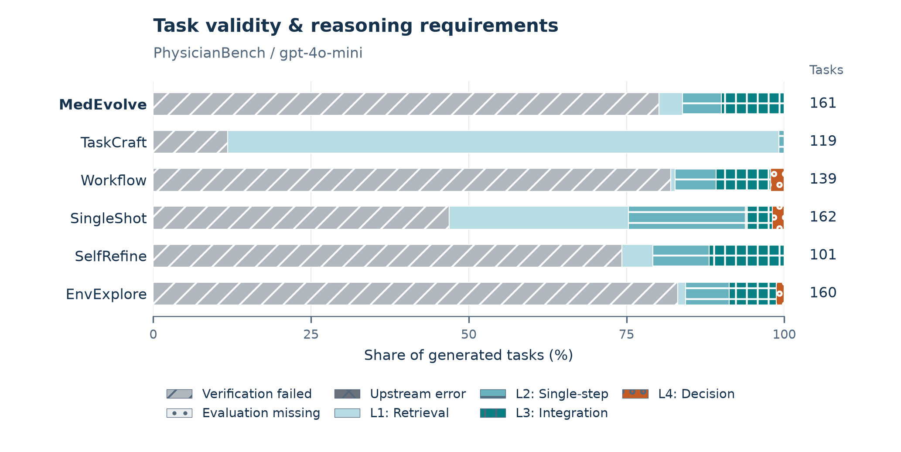

图 2. PhysicianBench、GPT-4o-mini 条件的生成任务核验状态与推理层级。横轴为占实际生成量的比例，右侧报告生成题数；四级推理要求仅针对核验通过任务。

TaskCraft 在四个条件下的核验通过率为 88.2%–97.7%，但高阶有效题数均为零，主要生成事实查询任务。MedEvolve 的核验通过率为 19.9%–71.2%，通过核验的任务中包含较多整合推理题；这体现任务深度与可靠产出之间的取舍，不能仅由高阶占比推断整体优势。GPT-5.4-nano 条件下，SelfRefine 仅生成 7 或 12 题，其通过率与质量均值需结合这一较小产量解读。

### 4.2 策略自进化

实验比较初始策略与四轮更新后的策略，共五个检查点。各检查点在同一独立患者集上生成并评价，固定探索指导、模型、初始方向配比、种子、题数上限和公共评价，独立成绩不参与更新。四轮使用不同进化患者批次，每位患者的生成与评价预算一致。PhysicianBench 四轮患者数为 6、7、7、7，MedAgentBench 为 6、6、6、7；五个检查点的独立评测正在进行。

图 3 分别展示四维质量、核验通过率和高阶有效题数。通过率以具有核验结果的任务为分母，高阶有效题需通过核验且被标为 3–4 级。曲线附患者簇区间及评分、核验覆盖；不同训练批次上的成绩不替代固定患者上的策略比较。

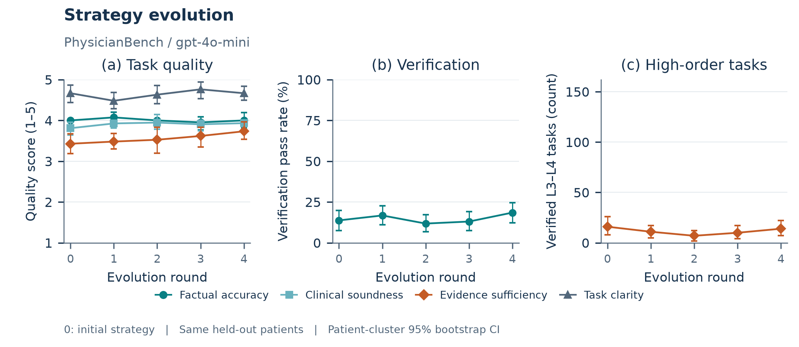

图 3. 固定独立患者集上的策略自进化。0 为初始策略，1–4 为逐轮更新后的策略。（a）核验通过任务的四维质量均值；（b）公共核验通过率；（c）核验通过且推理层级为 3–4 的任务数。PhysicianBench、GPT-4o-mini 条件的五个检查点均覆盖相同 81 位独立患者。质量评分题数依次为 21、27、19、21、30，核验通过题数依次为 22、27、19、21、30。区间为患者簇 95% 重采样区间。

MedAgentBench、gpt-4o-mini 的核验通过率由 11.0% 变为 6.7%，高阶有效题数由 12 变为 10。 MedAgentBench、gpt-5.4-nano 的核验通过率由 80.7% 变为 71.7%，高阶有效题数由 95 变为 78。 PhysicianBench、gpt-4o-mini 的核验通过率由 13.8% 变为 18.5%，高阶有效题数由 16 变为 14。 PhysicianBench、gpt-5.4-nano 的核验通过率由 72.4% 变为 73.8%，高阶有效题数由 93 变为 99。 不同完整条件的核验量与高阶任务量变化方向不完全一致；更新策略并不保证独立效果提高。完整曲线见附录F。

### 4.3 组件消融

表 2 比较完整 MedEvolve、去数据探索、去环境探索和关闭反馈更新。每组保留其余组件；关闭更新组保留双探索和初始指导，在相同进化批次上生成与评价，但不修订策略。各组固定独立患者、模型、初始方向配比、种子、题数上限和公共评价。

表 2. 四组组件消融。四维质量依次为事实准确性、临床合理性、证据充分性和题目清晰度（1–5 分）。正式结果附患者簇区间和覆盖，并按环境与生成模型分别报告。

| 配置 | 核验通过题数 | 四维质量 | 高阶有效题数 | 生成 token |
| --- | --- | --- | --- | --- |
| 完整 MedEvolve | — | — / — / — / — | — | — |
| 去数据探索 | — | — / — / — / — | — | — |
| 去环境探索 | — | — / — / — / — | — | — |
| 关闭反馈更新 | — | — / — / — / — | — | — |

四轮结束后比较核验通过量、独立质量维度、高阶有效量和实际生成 token。质量仅统计通过核验且评分有效的任务，关闭更新组节省的反馈与更新调用计入成本差异。EnvExplore 在主实验中作为组合对照，不用于单独归因某个组件。正式消融结果尚未填入。

### 4.4 下游经验学习

PhysicianBench 下游实验将六种任务来源分别接入 OpenClaw、ACE 和 Reflexion（Shinn et al., 2023），并将 MedEvolve 接入 Hermes Agent，共 19 个来源与 Harness 组合。MedEvolve 的四个基座均使用主实验中生成并通过核验的任务。模型权重固定，来源在同一 Harness 内相对统一初始状态比较。各来源选取相同数量的核验通过只读任务，不超过最小有效产量；以种子 42 按任务划分 70% 训练、30% 辅助测试，训练数向下取整。PhysicianBench 冻结配置每来源 25 题（17 训练、8 测试），使用 GPT-4o-mini、训练一轮；其他环境以冻结清单为准。

训练每题使用新会话和医疗实例，答案与证据仅在执行后供评审与学习，跨题保留技能、记忆或策略手册。训练结束后冻结经验，不按测试成绩选版本。测试关闭写入和后台学习，每题从冻结快照及独立会话、实例开始。各 Harness 的机制与限制见附录 E。

表 3. PhysicianBench 共同100题上的下游记录。成功率以计划100题为分母；检查点得分仅统计有效评分。区间为同题患者簇重采样区间。执行故障保留在覆盖中，覆盖不足的组不能作为完整进化比较。

| 基座 | 任务来源 | 成功率初始/最终% | 提升百分点 [95%区间] | 有效评分初始/最终 | 检查点得分初始/最终% |
| --- | --- | --- | --- | --- | --- |
| ace | MedEvolve | 0.0 / 0.0 | 0.0 [0.0,0.0] | 98 / 93 | 5.39 / 5.78 |
| openclaw | MedEvolve | 运行中 | — | — | — |
| reflexion | MedEvolve | 0.0 / 0.0 | 0.0 [0.0,0.0] | 87 / 75 | 2.01 / 1.05 |
| hermes | MedEvolve | 运行中 | — | — | — |
| ace | TaskCraft | 0.0 / 0.0 | 0.0 [0.0,0.0] | 99 / 95 | 5.14 / 8.20 |
| openclaw | TaskCraft | 0.0 / 0.0 | 0.0 [0.0,0.0] | 99 / 97 | 9.20 / 10.37 |
| reflexion | TaskCraft | 运行中 | — | — | — |
| ace | Workflow | 0.0 / 0.0 | 0.0 [0.0,0.0] | 99 / 96 | 5.48 / 5.87 |
| openclaw | Workflow | 0.0 / 0.0 | 0.0 [0.0,0.0] | 99 / 98 | 11.59 / 11.64 |
| reflexion | Workflow | 运行中 | — | — | — |
| ace | SingleShot | 0.0 / 0.0 | 0.0 [0.0,0.0] | 100 / 97 | 4.62 / 7.76 |
| openclaw | SingleShot | 0.0 / 0.0 | 0.0 [0.0,0.0] | 97 / 98 | 12.49 / 8.38 |
| reflexion | SingleShot | 运行中 | — | — | — |
| ace | SelfRefine | 运行中 | — | — | — |
| openclaw | SelfRefine | 运行中 | — | — | — |
| reflexion | SelfRefine | 运行中 | — | — | — |
| ace | EnvExplore | 运行中 | — | — | — |
| openclaw | EnvExplore | 运行中 | — | — | — |
| reflexion | EnvExplore | 运行中 | — | — | — |

ace / MedEvolve 的成功题数为 0/0，有效评分覆盖为 98/93。 ace / SingleShot 的成功题数为 0/0，有效评分覆盖为 100/97。 ace / TaskCraft 的成功题数为 0/0，有效评分覆盖为 99/95。 ace / Workflow 的成功题数为 0/0，有效评分覆盖为 99/96。 openclaw / SingleShot 的成功题数为 0/0，有效评分覆盖为 97/98。 openclaw / TaskCraft 的成功题数为 0/0，有效评分覆盖为 99/97。 openclaw / Workflow 的成功题数为 0/0，有效评分覆盖为 99/98。 reflexion / MedEvolve 的成功题数为 0/0，有效评分覆盖为 87/75。 执行和评分故障不等同于临床失败，覆盖不足的组不能作为完整进化比较。零提升及零宽区间不证明经验学习无效。OpenClaw的102次训练会话均低于原生后台复盘10轮门槛，经验未更新。其余11组仍在运行；OpenClaw历史认证故障记录正在补评。

MedEvolve 的 17 道训练题涉及 16 位患者，8 道辅助测试题涉及 6 位患者，训练与辅助测试的患者不重叠；这些患者均在 100 位官方评测患者中。四个基座使用完全相同的训练及辅助测试题目。下游结果适用于患者重叠条件下的任务迁移，需与未见患者的泛化评价区分。

主要评价使用共同官方任务与原生评分。对官方任务集 $B$ 和经验状态 $h$，定义

$$
A(h)=\frac{N_{\mathrm{confirmed\ success}}(h)}{|B|},\qquad
\Delta_m=100\bigl(A(h_m)-A(h_0)\bigr),
$$

其中 $h_0$ 与 $h_m$ 为初始及来源训练后的状态。分子为有效评分确认成功的任务数，分母包含全部计划任务，执行和评分故障与临床失败分别报告。表 3 报告最终成功率和百分点变化，包括初始与最终均有效评分的同题配对变化。辅助合成测试只检验各来源自身分布，不用于跨来源排名，并记录患者重叠与题目近重复。

## 5 结论

MedEvolve 通过数据与环境双探索选择由当前病例支持的问题，再利用核验和解题反馈跨患者更新生成指导与方向权重。评价协议将有效任务构建与下游经验学习联系起来，任务生成实验显示，高核验通过率、高阶任务产出与生成覆盖需要联合评价；固定患者评测显示策略更新效果因环境与模型而异，不保证高阶有效产量提高；下游比较仍需结合评分覆盖和原生学习触发情况解释。

## 局限性（Limitations）

病例记录的完整性、时间信息和模型输入预算限制了可发现的提问模式，轨迹裁剪也可能遗漏关键依据。同一环境内的患者独立划分只能检验该环境中的迁移，跨机构或跨数据来源的泛化仍需另外评价。当前生成采用回顾性信息访问，不启用时间视角隔离，因此不代表临床当时可获得的信息范围。

这些数据限制也影响自动评价。两个模型的评分聚合不能消除共同偏差，现有记录未必足以判定所有临床方案；质量评分又仅覆盖核验通过且评分成功的任务，复杂任务可能因单条引用失败而被整体拒绝。因此，评分均值需要结合评价覆盖和有效产量解释。

对策略自进化的解释同样受比较条件约束。独立评测固定方向配比，主要检验生成指导更新，未覆盖更新后方向分布的整体效果。反馈模型给出的归因和建议也可能有误，策略更新不保证后续结果单调改善。

下游实验中，合成训练与辅助测试按任务划分，可能共享患者，官方测试也可能与经验训练共享底层记录。当前单种子、单次训练配置不能衡量跨运行稳定性，患者簇重采样仅反映测试样本不确定性。不同 Harness 的原生学习触发和调用限制存在差异，任务来源的比较因而限定在同一 Harness 内。

## 参考文献

Jiang, Yixing, et al. 2025. [MedAgentBench: A Realistic Virtual EHR Environment to Benchmark Medical LLM Agents](https://arxiv.org/abs/2501.14654). arXiv:2501.14654.

Liu, Ruoqi, et al. 2026. [PhysicianBench: Evaluating LLM Agents in Real-World EHR Environments](https://arxiv.org/abs/2605.02240). arXiv:2605.02240.

Shi, Dingfeng, et al. 2025. [TaskCraft: Automated Generation of Agentic Tasks](https://arxiv.org/abs/2506.10055). arXiv:2506.10055.

Mai, Shinji, et al. 2025. [CuES: A Curiosity-driven and Environment-grounded Synthesis Framework for Agentic RL](https://arxiv.org/abs/2512.01311). arXiv:2512.01311.

Shinn, Noah, et al. 2023. [Reflexion: Language Agents with Verbal Reinforcement Learning](https://arxiv.org/abs/2303.11366). arXiv:2303.11366.

Zhai, Yunpeng, et al. 2025. [AgentEvolver: Towards Efficient Self-Evolving Agent System](https://arxiv.org/abs/2511.10395). arXiv:2511.10395.

Madaan, Aman, et al. 2023. [Self-Refine: Iterative Refinement with Self-Feedback](https://arxiv.org/abs/2303.17651). arXiv:2303.17651.

Kassis, Timothy, Vinayak Agarwal, Yuhuan He, Darshil Patel, and Aubrey M. Brueckner. 2026. [Scientific Agent Skills: A Library of Procedural Knowledge for Research Agents](https://arxiv.org/abs/2609.00065). https://doi.org/10.48550/arXiv.2609.00065.

## 附录

### A 探索与生成接口

#### A.1 数据探索

探索工具提供开放患者名单、预算内轨迹及可选压缩摘要。输入材料保留患者标识、原始来源和覆盖标记，输出为不绑定患者的自然语言指导。指导归纳数据组织、时间变化、事件关系、证据引用与可支持的问题，不保留个体临床值或来源编号。

压缩摘要用于定位模式，原始记录用于支持具体事实。记录缺失与材料裁剪分别解释。指导中的时间窗口、记录数量或临床关系属于模型归纳的提问约束，不构成对所有患者统一适用的硬编码医学规则。

#### A.2 环境探索

环境探索在独立实例中访问开放患者的原生只读工具。指导记录已验证参数、返回结构、分页与裁剪行为、典型检索方式，并区分调用失败和未验证能力。环境内的具体患者观察不进入通用指导。

#### A.3 指导修订实例

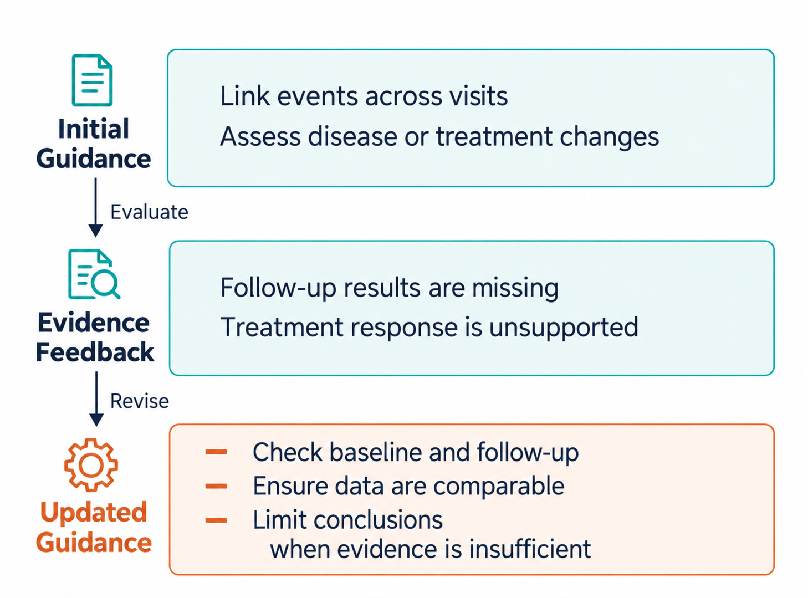

图 4. 一次策略自进化中的指导修订。核验反馈指出随访证据不足，更新后的指导增加基线、随访与数据可比性检查，并限定证据不足时的结论。图中文字根据一次进化记录概括。

#### A.4 任务生成与策略

任务包含患者标识、临床题型、问题、候选参考答案、来源标识与逐来源事实声明，以及执行要求；当前公共生成接口要求时间视角字段为空，执行要求为只读。生成调用输入预算内轨迹、两类探索指导、当前生成指导和两个采样方向，输出最多两题。

生成策略由自然语言指导和方向列表组成；方向包含五类临床题型之一、难度描述与非负权重。方向按权重采样，允许同一题型对应不同临床模式；至少一个权重为正。数据与环境指导在策略更新期间固定，更新只修订生成指导和方向列表。进化阶段按当前方向权重抽样；独立评测固定初始方向列表与抽样种子，读取当前策略的生成指导。

### B 环境、患者与信息访问

表 4. 生成侧患者划分。

| 环境 | 患者总数 | 进化集 | 独立评测集 | 两轮进化患者数 |
| --- | --- | --- | --- | --- |
| PhysicianBench | 108 | 27 | 81 | 13 / 14 |
| MedAgentBench | 100 | 25 | 75 | 12 / 13 |

PhysicianBench 的生成患者池为 108 人，MedAgentBench 为官方范围内的 100 人。按种子 42 和既有探索暴露约束冻结进化与评测名单。进化患者分为互不重叠的两轮：PhysicianBench 为 13 与 14 人，MedAgentBench 为 12 与 13 人；评测患者分别为 81 与 75 人。

原始轨迹按记录时间组织，模型输入按预算选取；证据核验读取原始来源，不以输入摘要替代来源。初始探索和任务生成只开放查询工具。解题工具依环境与任务执行要求提供，经验训练的合成任务进一步限定为只读。当前公共生成接口未启用时间视角属性，问题中的时间限定不等同于服务端隐藏后续记录。

经验学习另按合成任务划分训练与辅助测试，不能与生成侧患者划分混用。冻结清单记录选中题目、患者、训练与测试划分、文件摘要及生成来源。官方任务评测另记录任务版本、患者范围及与经验训练的重叠。

### C 生成方法与预算

TaskCraft 将患者记录与只读 FHIR 工具映射到原方法的结论抽取、原子任务生成、核验与扩展流程。深度和宽度分支均从原子任务出发，彼此没有先后依赖；两条分支共享生成总预算。原子、深度和宽度候选的实际产量及接纳情况分别记录，以区分扩展机制和最终筛选的影响。医疗适配与原论文完整实验复现分别解释。

Workflow 固定执行定位、生成和内部检查，检查只筛选候选。SingleShot 根据轨迹单次生成最多两题。SelfRefine 在同一患者批次内执行初稿、自反馈和修订，最多三次自评、两次修订，全部通过时提前结束。EnvExplore 先获取环境指导，再用固定初始策略生成任务。各方法共享输出结构和公共评价，内部调用与筛选记录分别保存。

主方法初始探索完成后执行两轮生成侧策略进化，每轮按患者归纳反馈并汇总更新。批次输出的结构或配额校验失败保留为生成失败。反馈和更新调用失败不视为进化成功。输入裁剪、实际调用与预算耗尽分别记录。

模型路由、上下文上限、输出限制和工具预算以冻结运行配置为准。同一比较中报告各方法预算与实际用量；相同出题数量不表述为严格相同 token 预算。探索和更新计入主方法总成本，公共评价成本单列，历史复用调用按原始记录去重计数。

### D 评分、汇总与统计

#### D.1 质量与推理深度

表 5. 四维质量评分标准。各维度独立评分。

| 分数 | 事实准确性 | 临床合理性 | 证据充分性 | 题目清晰度 |
| --- | --- | --- | --- | --- |
| 5 | 数值、单位、药物、剂量与时间准确 | 推理严密，方案与风险考虑充分 | 关键事实和结论均有明确支持 | 目标、背景与操作要求明确 |
| 4 | 核心准确，存在次要细节瑕疵 | 基本合理，个别步骤有不足 | 主要结论有支持，细节引用不完整 | 基本清晰，个别细节需推断 |
| 3 | 多数准确，少量非关键错误 | 方向正确，但遗漏重要考虑 | 核心结论有支持，部分推理缺引用 | 方向明确，但缺关键背景 |
| 2 | 关键事实错误 | 有明显漏洞或违背常规实践 | 关键结论缺支持 | 目标模糊、矛盾或缺必要限定 |
| 1 | 多处严重错误或编造数据 | 推理错误或方案有明显风险 | 主要依赖未支持的推断或编造 | 无法理解或执行 |

推理深度依据问题要求及证据结构标注：第 1 级直接读取事实，第 2 级结合记录与临床知识完成单步判断，第 3 级跨记录比较或整合信息，第 4 级综合证据权衡风险收益并提出方案。临床题型与推理层级分别记录，不把治疗规划题自动判为最高层级。

对任务 $i$、质量维度 $d$，两个模型的原始评分为 $s_{i,d}^{(1)}$ 与 $s_{i,d}^{(2)}$，最终评分为

$$
s_{i,d}=\left\lfloor\operatorname{median}\left(s_{i,d}^{(1)},s_{i,d}^{(2)}\right)\right\rfloor.
$$

难度采用同样聚合规则，保留两个原始层级与理由。正式协议要求两份有效输出，不以单个成功裁判替代缺失评价。质量评分材料包含题目、参考答案、证据、轨迹与核验结果；难度评分依据任务要求和自动复杂度。原始评分用于分歧分析。

#### D.2 证据结构与比率

对引用来源去重得到 $S_i$，证据数量为 $|S_i|$，资源类型数由可识别类型前缀去重得到。引用记录中可解析的时间集合为 $T_i$，其跨度为

$$
\Delta_i=\frac{\max T_i-\min T_i}{1\text{ 天}}.
$$

无可解析时间时记缺失，只有一个可解析时间时为零。报告时间可解析任务数，跨度分布和中位数仅使用非缺失值。

表 6. 生成任务的比率分母。

| 指标 | 分子 | 分母 |
| --- | --- | --- |
| 生成覆盖率 | 实际生成题数 | 请求题数 |
| 核验覆盖率 | 具有核验结果的题数 | 实际生成题数 |
| 核验通过率 | 核验通过题数 | 具有核验结果的题数 |
| 高阶题占比 | 深度为 3–4 的题数 | 具有难度评分的题数 |
| 维度高质量占比 | 该维度评分不低于 4 的题数 | 具有该维度评分的题数 |
| 全部生成任务完成率 | 判定完成题数 | 实际生成题数 |
| 已评价任务完成率 | 判定完成题数 | 具有完成评价的题数 |

分母为零时记缺失。质量均值、层级分布和证据结构分别报告覆盖数。临床失败、证据不足、题意歧义、工具故障、环境故障与模型故障分别汇总，不由运行状态推断任务完成。

#### D.3 不确定性估计

统计方案以患者为簇，进行 1,000 次有放回重采样，种子为 42，取分布的 2.5% 与 97.5% 分位数作为 95% 区间。患者的全部题目共同进入样本，相同患者上的方法差异保留配对。重采样分母为零的指标记缺失，不转换为零；区间随指标有效重采样次数报告。

官方任务的初始与最终状态先按任务标识配对，再按患者簇重采样；共同任务和共同有效评分分别报告。单次训练结果不附跨训练标准差。

### E 经验学习与官方评测

表 7. 四种 Harness 的经验载体与更新机制。

| Harness | 持久化经验 | 训练更新 | 测试状态 |
| --- | --- | --- | --- |
| OpenClaw | 技能与独立状态目录 | 原生 Skill Workshop，记录是否触发 | 读取冻结技能，关闭学习与后台维护 |
| Hermes Agent | 技能与记忆 | 原生技能和记忆机制 | 保留读取，关闭写入与整理 |
| ACE | 策略手册 | Reflector 和 Curator 更新 | 只运行 Generator |
| Reflexion | 反思与可迁移经验 | 失败反思及限定次数重试 | 只运行 Actor，读取经验 |

各组独立保存配置和经验，从统一初始状态开始。Reflexion 的跨任务经验提炼为医疗适配：保存适用条件、操作步骤和错误教训，不保存患者标识、个体临床值或逐题答案；新题按冻结规则读取最多三条相关经验。测试不根据评分进行反思或重试。

PhysicianBench 当前配置每来源 25 题，训练 17 题、辅助测试 8 题，训练一轮、种子 42。执行与经验更新使用 GPT-4o-mini，单题执行轮次上限 30、工具调用上限 200、执行超时 900 秒，学习轮次上限 10、超时 300 秒。各 Harness 采用原生可用限制，后台调用或原生组件内部用量无法完整计数时标为未知，不表述为统一硬预算拦截。

官方评测锁定任务与评分资产版本。PhysicianBench 使用官方任务和检查点评分，提供实际文件交付、执行轨迹和本题 FHIR 实例；任务成功率与平均检查点得分分别报告。MedAgentBench 按冻结配置选择任务版本并使用官方完成评判，版本间结果分别报告。官方资产缺失或评分故障保留为不可用结果，不以公共模型裁判替代原生分数。

测试评分与解题隔离，评分完成前保留实际使用的医疗实例。每题使用冻结经验副本，不将参考答案、评分结果或完整会话回写到最终经验。测试前后核对冻结经验摘要，报告计划任务数、评分覆盖、初始与最终成绩以及完整与配对口径的提升。

### F 补充结果与案例

<!-- evolution-results -->

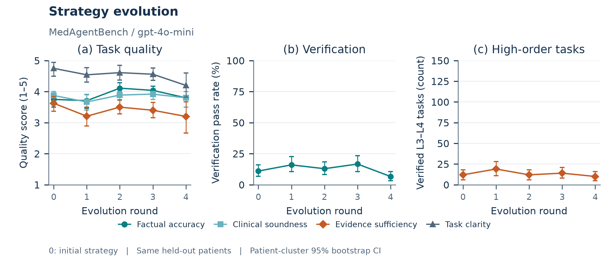

MedAgentBench、gpt-4o-mini四轮策略更新的独立评测。已有5/5个完整检查点，使用相同患者集，固定初始方向配比；缺失检查点不连线，误差线为患者簇95%区间。

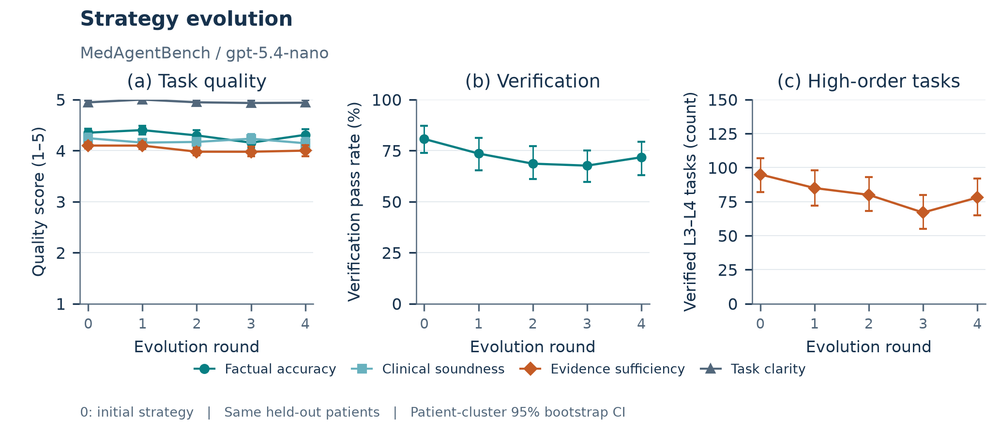

MedAgentBench、gpt-5.4-nano四轮策略更新的独立评测。已有5/5个完整检查点，使用相同患者集，固定初始方向配比；缺失检查点不连线，误差线为患者簇95%区间。

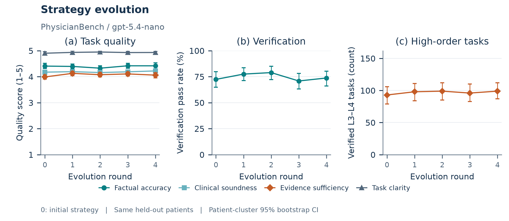

PhysicianBench、gpt-5.4-nano四轮策略更新的独立评测。已有5/5个完整检查点，使用相同患者集，固定初始方向配比；缺失检查点不连线，误差线为患者簇95%区间。

<!-- /evolution-results -->

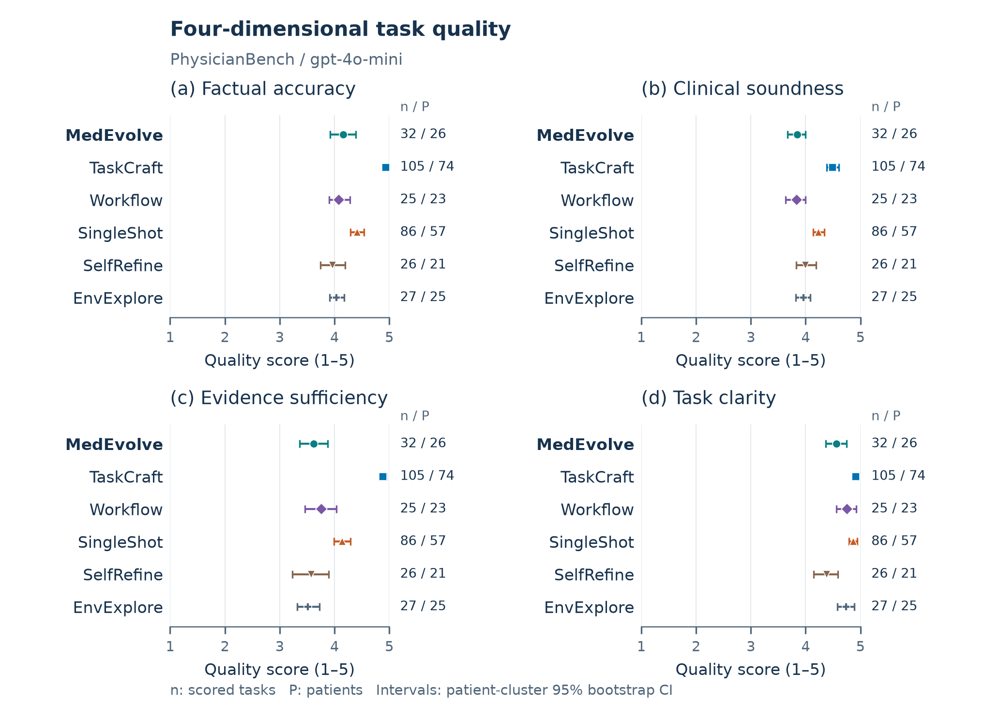

PhysicianBench、gpt-4o-mini 条件的四维质量。仅统计核验通过且评分有效的任务；误差线为患者簇 95% 重采样区间（1,000 次，种子 42），n 与 P 分别为评分题数和患者数。

MedAgentBench、gpt-4o-mini 条件的四维质量。仅统计核验通过且评分有效的任务；误差线为患者簇 95% 重采样区间（1,000 次，种子 42），n 与 P 分别为评分题数和患者数。

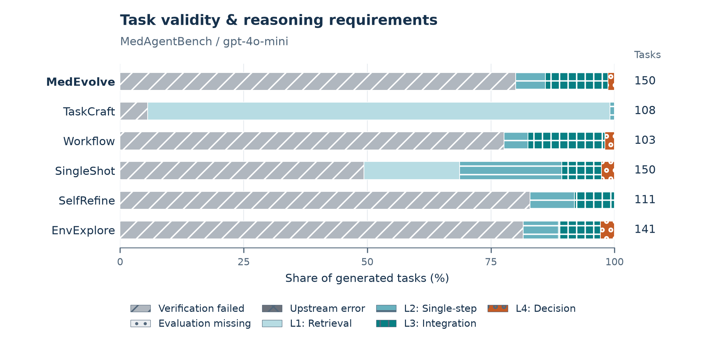

MedAgentBench、gpt-4o-mini 条件的核验状态与推理层级，口径与图 2 相同。

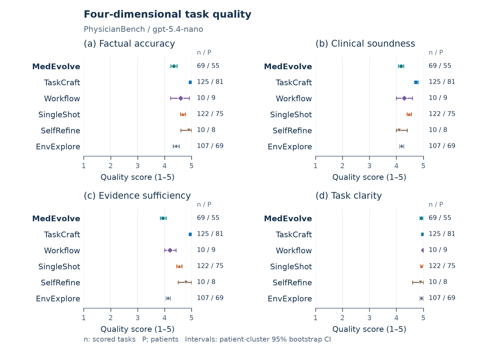

PhysicianBench、gpt-5.4-nano 条件的四维质量。仅统计核验通过且评分有效的任务；误差线为患者簇 95% 重采样区间（1,000 次，种子 42），n 与 P 分别为评分题数和患者数。

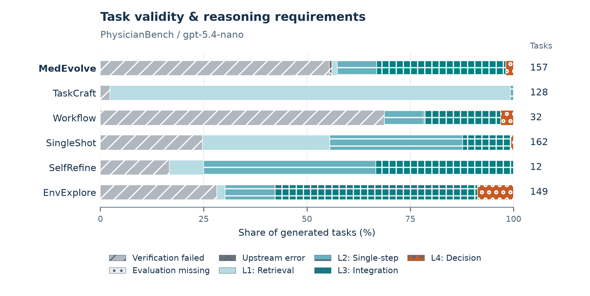

PhysicianBench、gpt-5.4-nano 条件的核验状态与推理层级，口径与图 2 相同。

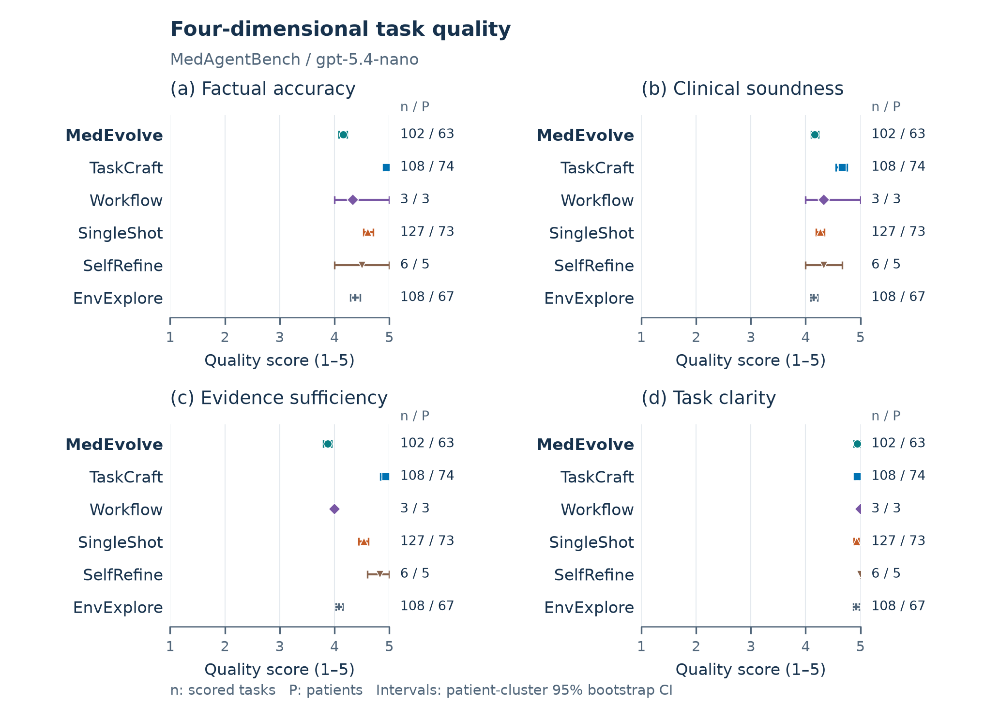

MedAgentBench、gpt-5.4-nano 条件的四维质量。仅统计核验通过且评分有效的任务；误差线为患者簇 95% 重采样区间（1,000 次，种子 42），n 与 P 分别为评分题数和患者数。

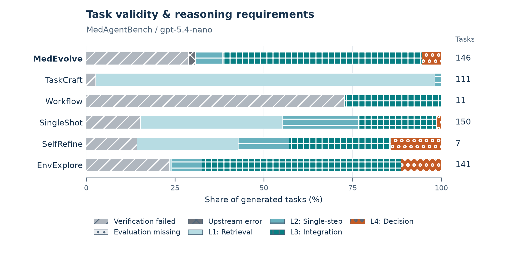

MedAgentBench、gpt-5.4-nano 条件的核验状态与推理层级，口径与图 2 相同。

表 8. 推理要求与证据结构。核验通过率以已有核验结果为分母；高阶与证据指标统计核验通过且具有难度评分的任务。方括号为患者簇 95% 区间（1,000 次重采样，种子 42），高阶区间对应分子题数。跨度括号内为时间可解析题数。
**PhysicianBench · gpt-4o-mini**
| 方法 | 通过率% [95%区间] | 高阶题数 / 评分题数 [95%区间] | 高阶占比 | 平均证据数 | 平均资源类型数 | 跨度中位数（天） |
| --- | --- | --- | --- | --- | --- | --- |
| MedEvolve | 19.9[13.2,27.2] | 16/32 [9,24] | 50.0% | 2.41 | 1.28 | 0.36 (32) |
| TaskCraft | 88.2[82.6,94.0] | 0/105 [0,0] | 0.0% | 1.24 | 1.04 | 0.00 (105) |
| Workflow | 18.0[12.1,24.8] | 15/25 [8,22] | 60.0% | 2.88 | 1.36 | 6.00 (25) |
| SingleShot | 53.1[43.8,62.3] | 10/86 [4,16] | 11.6% | 2.13 | 1.08 | 0.00 (86) |
| SelfRefine | 25.7[16.7,35.7] | 12/26 [6,19] | 46.2% | 2.62 | 1.19 | 2.00 (26) |
| EnvExplore | 16.9[11.2,22.5] | 14/27 [7,22] | 51.9% | 2.59 | 1.22 | 1.00 (27) |
**MedAgentBench · gpt-4o-mini**
| 方法 | 通过率% [95%区间] | 高阶题数 / 评分题数 [95%区间] | 高阶占比 | 平均证据数 | 平均资源类型数 | 跨度中位数（天） |
| --- | --- | --- | --- | --- | --- | --- |
| MedEvolve | 20.0[13.3,26.7] | 21/30 [13,29] | 70.0% | 2.47 | 1.23 | 0.62 (30) |
| TaskCraft | 94.4[89.0,98.9] | 0/102 [0,0] | 0.0% | 1.27 | 1.01 | 0.00 (102) |
| Workflow | 22.3[15.1,29.5] | 18/23 [11,26] | 78.3% | 3.39 | 1.09 | 3.00 (23) |
| SingleShot | 50.7[42.7,58.0] | 16/76 [9,23] | 21.1% | 2.53 | 1.04 | 0.43 (76) |
| SelfRefine | 17.1[9.2,25.9] | 9/19 [3,16] | 47.4% | 2.89 | 1.05 | 1.68 (19) |
| EnvExplore | 18.4[12.6,25.0] | 16/26 [9,24] | 61.5% | 2.54 | 1.15 | 2.00 (26) |
**PhysicianBench · gpt-5.4-nano**
| 方法 | 通过率% [95%区间] | 高阶题数 / 评分题数 [95%区间] | 高阶占比 | 平均证据数 | 平均资源类型数 | 跨度中位数（天） |
| --- | --- | --- | --- | --- | --- | --- |
| MedEvolve | 44.6[37.1,52.6] | 52/69 [41,65] | 75.4% | 5.20 | 1.75 | 18.87 (69) |
| TaskCraft | 97.7[94.9,100.0] | 0/125 [0,0] | 0.0% | 1.22 | 1.03 | 0.00 (125) |
| Workflow | 31.2[14.3,50.0] | 7/10 [3,12] | 70.0% | 6.00 | 1.90 | 1.17 (10) |
| SingleShot | 75.3[68.5,81.5] | 20/122 [12,29] | 16.4% | 3.89 | 1.27 | 0.64 (122) |
| SelfRefine | 83.3[61.5,100.0] | 4/10 [1,8] | 40.0% | 2.50 | 1.10 | 20.00 (10) |
| EnvExplore | 71.8[64.1,78.8] | 86/107 [72,100] | 80.4% | 6.21 | 1.65 | 22.75 (107) |
**MedAgentBench · gpt-5.4-nano**
| 方法 | 通过率% [95%区间] | 高阶题数 / 评分题数 [95%区间] | 高阶占比 | 平均证据数 | 平均资源类型数 | 跨度中位数（天） |
| --- | --- | --- | --- | --- | --- | --- |
| MedEvolve | 71.2[61.6,79.9] | 90/101 [77,104] | 89.1% | 6.76 | 1.32 | 8.39 (101) |
| TaskCraft | 97.3[94.1,100.0] | 0/108 [0,0] | 0.0% | 1.18 | 1.01 | 0.00 (108) |
| Workflow | 27.3[0.0,53.9] | 3/3 [0,7] | 100.0% | 8.67 | 2.00 | 38.04 (3) |
| SingleShot | 84.7[78.7,90.0] | 35/127 [26,44] | 27.6% | 5.04 | 1.09 | 0.90 (127) |
| SelfRefine | 85.7[50.0,100.0] | 3/6 [0,8] | 50.0% | 7.67 | 1.00 | 1.50 (6) |
| EnvExplore | 76.6[69.9,82.9] | 95/108 [83,107] | 88.0% | 6.51 | 1.56 | 2.90 (108) |

证据数量、资源类型和时间跨度描述支持任务的记录结构，不单独代表临床推理质量。经过作者核对的案例与下游辅助测试结果尚未报告。

### G 写作辅助工具

中文稿的结构组织、方法描述核对与证据状态检查使用 Scientific Agent Skills 的 scientific-writing 技能（Kassis et al., 2026）辅助。文献与科学结论的最终核验由作者负责。
